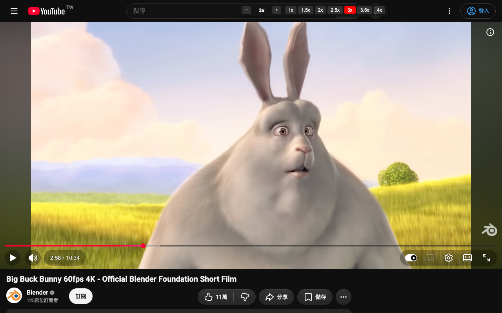

# yt-playback-speed


讓 YouTube 突破原生 2 倍速上限的 Chrome 擴充功能。在頁面上加一個可拖曳的小面板，一鍵切換倍速，最高支援 16x。



## 功能

- 預設倍速按鈕：1x、1.5x、2x、2.5x、3x、3.5x、4x
- `−` / `+` 以 0.25x 為單位微調（範圍 0.25x–16x）
- 快捷鍵：`Alt + .` 加速、`Alt + ,` 減速
- 自動記住上次使用的倍速，下一部影片沿用
- 面板預設嵌在 YouTube 頂端列，也可拖曳到任意位置並記住；雙擊面板空白處可放回頂端列

## 安裝（開發者模式）

1. 下載或 clone 這個 repo：
   ```bash
   git clone https://github.com/BillyE5/yt-playback-speed.git
   ```
2. 開啟 Chrome，前往 `chrome://extensions`
3. 打開右上角的「開發人員模式」
4. 點「載入未封裝項目」，選擇這個資料夾
5. 打開任一 YouTube 影片，頂端列搜尋框右邊就會出現倍速面板

## 自訂

在 `content.js` 開頭可以調整：

| 常數 | 說明 | 預設值 |
| --- | --- | --- |
| `PRESETS` | 預設倍速按鈕 | `[1, 1.5, 2, 2.5, 3, 3.5, 4]` |
| `MIN_SPEED` / `MAX_SPEED` | 倍速範圍 | `0.25` / `16` |
| `STEP` | 每次微調的幅度 | `0.25` |

## 檔案結構

```
manifest.json   擴充功能設定（Manifest V3）
content.js      注入 YouTube 頁面的主程式
style.css       面板樣式
icons/          擴充功能圖示（icon.svg 為原始檔）
store/          商店截圖與上架文案
```

## 隱私權

不收集任何資料，詳見 [PRIVACY.md](PRIVACY.md)。

## License

[MIT](LICENSE)
